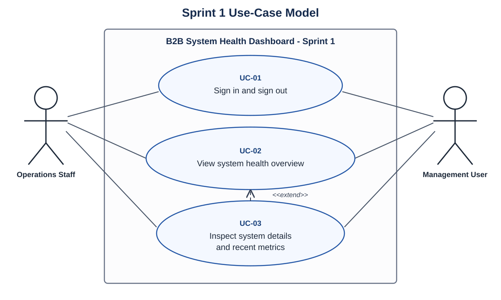

# Sprint 1 Use-Case Analysis

This directory contains the conceptual Object-Oriented Analysis for the three user goals selected for the Sprint 1 vertical slice. The models describe what users need to achieve and deliberately avoid React, Spring Boot, database and API implementation detail.

## Actors

- **Operations Staff** monitor service health and investigate abnormal systems.
- **Management User** reviews the overall health of business systems and examines supporting detail when necessary.

Both actors use the same read-only Sprint 1 monitoring flow. More detailed role-specific administration is deferred to the Product Backlog.

## Selected use cases

| ID | User goal | Brief | Jira traceability |
| --- | --- | --- | --- |
| UC-01 | Sign in and sign out | [UC-01 - Sign in and sign out](uc-01-sign-in-and-sign-out.md) | ELG2-10, ELG2-15 |
| UC-02 | View system health overview | [UC-02 - View system health overview](uc-02-view-system-health-overview.md) | ELG2-14, ELG2-16 |
| UC-03 | Inspect system details and recent metrics | [UC-03 - Inspect system details and recent metrics](uc-03-inspect-system-details.md) | ELG2-12, ELG2-13, ELG2-16 |

## UML use-case diagram

The editable PlantUML source is available in [use-case-diagram.puml](use-case-diagram.puml). UC-03 extends UC-02 because inspecting one system is an optional next step after viewing the overview.

## Scope boundary

Sprint 1 covers authentication, the health overview and read-only investigation of one monitored system. Full role administration, monitored-system management, alert-management UI, notifications and external monitoring agents remain outside these three use cases and stay in the Product Backlog.
