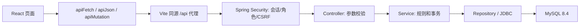

# 项目功能、接口与前端数据说明

检查日期：2026-10-29（Australia/Sydney）。依据当前代码、接口合同及本机真实响应。本轮补齐前端，不修改后端实现、数据库结构或运行策略。

新版布局：左侧依次为 Dashboard、System、Alert Center、My profile、Metric retention；桌面鼠标移入展开，移动端点击左上角账号展开，选中后只显示对应页面。Management 仍隐藏仅 Operations 可访问的 Metric retention。系统详情依次为 Basic information（含合并后的状态提示和当前阈值说明）、Recent Metrics、Submit a metric reading；Management 的提交标签禁用。

交互修复：左上角显示当前账号及角色，点击展开 Logout；右上角退出入口已移除。桌面移出侧栏即收起，连接状态弹层可点击外部或按 Esc 关闭。Recent Metrics 与提交标签内不重复显示标题。本轮 94 项前端测试通过，生产构建通过；实际浏览器确认账号菜单、外部关闭、三标签详情与 12 个系统同页。

快速导航：[检查结论](#audit) · [接口对照](#routes) · [权限](#roles) · [连接检查](#connection) · [概览卡片](#overview) · [系统列表](#systems) · [系统详情与历史](#history) · [告警](#alerts) · [个人资料与邮箱](#profile) · [指标归档](#retention) · [数据库](#database) · [技术流程](#technical) · [演示顺序](#demo)

## 1. 检查结论与本轮补齐

当前后端共有 **23 个方法与路径组合**：21 个业务/认证/维护接口，以及 2 个仍保留的旧查询接口。旧查询的能力已由前端采用的分页接口覆盖，不需要再做重复页面。

原先缺少的是指标归档的预览和执行入口。本轮新增仅 Operations 可见的 **Metric retention** 页面，显示服务器策略、截止时间、候选数量、单批上限；启用时先预览确认，再提交一个批次。还补充验证码到期时间、服务端重发冷却处理，修改邮箱时保留尚未结束的冷却时间。

本轮检查时，真实接口返回：12 个系统、Healthy 7、Warning 2、Critical 2、Offline 1，ACTIVE 告警 4 条。三个平均指标为 null；这是读数过期后的真实结果。

归档真实预览返回：`enabled=false`、`eligibleCount=2`、`batchSize=500`。因此前端能显示候选，但执行按钮禁用。没有通过修改数据库或后端配置来强行开启它。

验证结果：81 项前端测试通过、生产构建通过；双角色共 20 次真实 HTTP 读取通过（Management 访问维护接口按预期返回 403）。浏览器检查了运维归档入口和实际预览、管理角色隐藏入口、系统和历史页面。成功归档的前端分支通过模拟接口测试覆盖；本轮没有在活动演示库执行归档，也没有重新发送验证邮件。不能把这些描述为本轮已完成的真实写操作验收。

## 2. 后端接口是否有前端实现

| 方法、路径 | 前端位置/用途 | 本轮结论 |
| --- | --- | --- |
| GET `/api/health` | App → Integration check | 已实现 |
| GET `/api/auth/csrf` | 登录、退出和各写操作前取得令牌 | 已实现；无需独立页面 |
| POST `/api/auth/login` | Sign in | 已实现 |
| GET `/api/auth/me` | 恢复登录状态、确定当前用户/角色 | 已实现 |
| POST `/api/auth/logout` | 左上角账号菜单 → Logout | 已实现 |
| GET `/api/dashboard/summary` | 概览、分布图、告警操作后刷新统计 | 已实现 |
| GET `/api/systems` | 旧版系统数组，最多 500 个系统 | 前端使用下面的分页接口替代，非缺失 |
| GET `/api/systems/page` | 系统表、系统分页、告警系统筛选选项 | 已实现 |
| GET `/api/systems/{id}` | 单个系统详情、最近读数、原因、当前阈值 | 已实现 |
| POST `/api/systems` | Add system，运维可用 | 已实现 |
| PUT `/api/systems/{id}` | Edit system，运维可用 | 已实现 |
| GET `/api/systems/{id}/metrics` | 旧版最新 100 条数组 | 前端使用下面的游标历史替代，非缺失 |
| GET `/api/systems/{id}/metrics/history` | 时间范围、历史表、趋势图、Next readings / Previous readings | 已实现 |
| POST `/api/systems/{id}/metrics` | Submit a metric reading | 已实现 |
| GET `/api/alerts` | Alert Centre、系统/状态筛选及分页 | 已实现 |
| PATCH `/api/alerts/{id}/acknowledge` | Acknowledge | 已实现 |
| PATCH `/api/alerts/{id}/resolve` | Resolve | 已实现 |
| GET `/api/profile` | My profile | 已实现 |
| PUT `/api/profile` | Save email address | 已实现 |
| POST `/api/profile/email-verification` | Send verification code | 已实现；已补到期/冷却提示 |
| POST `/api/profile/email-verification/confirm` | Verify email | 已实现 |
| GET `/api/admin/metrics-retention/preview` | Metric retention → Refresh preview | 本轮补齐 |
| POST `/api/admin/metrics-retention/run` | Metric retention → Review → Confirm archive batch | 本轮补齐，尊重后端启用状态 |

没有添加的按钮及原因：后端没有删除系统、修改阈值、修改角色、密码重置、浏览/恢复归档记录、查看数据库迁移记录的业务 API。这些不属于“已有接口漏接”，不能在前端造一个实际无后端能力的功能。复杂采集代理、预测和监控告警的短信/邮件通知也不是当前实现的能力。

## 3. 两个角色到底能做什么

| 行为 | Operations | Management |
| --- | --- | --- |
| 查看概览、系统、详情、历史、告警 | 可以 | 可以 |
| 新增/修改监控系统 | 可以 | 不可以 |
| 提交指标 | 可以 | 不可以 |
| 确认/解决告警 | 可以 | 不可以 |
| 查看归档预览、执行已启用的归档 | 可以 | 不可以 |
| 查看自己的资料、修改自己的邮箱、验证邮箱 | 可以 | 可以 |

“Management 只读”是针对监控业务数据；它仍能维护自己的邮箱。前端隐藏不允许的入口，后端也独立检查角色。仅隐藏按钮不能构成安全控制。

## 4. 页首：登录用户与 Integration check

- **Username / Role**：当前会话所属账号及权限。不是 MySQL 登录账号。
- **CONNECTED / UP**：浏览器成功调用选定后端的 `/api/health`。它不是被监控服务器的状态，也不代表数据库中一定有数据。
- **Service**：当前连接的 Spring Boot 应用名称。两套后端可以返回同名，因此只看到这个名称不能区分数据库环境。
- **Checked**：后端生成这次健康响应的时间，不是最后一条监控数据的时间。
- **Check again**：重查后端可达性。不会刷新采集数据、创建系统或生成指标。

当前 HealthController 直接返回 UP 和当前时间，没有在每次健康请求中主动探测数据库或监控主机。要判断业务数据是否可读，还要看 summary、systems 等业务请求是否成功。

本地连接为：浏览器 `5173` → Vite `/api` 代理 → Spring Boot `8081` → MySQL 8.4 的 `3307`。这些是不同服务的端口。

## 5. Overview：每一张卡片的含义

| 显示项 | 实际含义 | 不能误解为 |
| --- | --- | --- |
| Total Systems | 数据库登记的监控对象总数 | 当前表格这一页的行数，或真实部署服务器的自动发现数量 |
| Healthy | 存储状态为 HEALTHY 的对象数 | 每个对象现在都有新鲜数据或已实际探活成功 |
| Warning | 最近一次提交时达到警告阈值的存储状态数 | 告警条数 |
| Critical | 最近一次提交时达到严重阈值的存储状态数 | 已发生故障的绝对证明 |
| Offline | 最近读数的 availability=false 所形成的状态数 | 当前网络连接被前端实时检测为断开 |
| Active alerts | 所有状态严格为 ACTIVE 的告警数量 | 告警当前页行数、受影响系统数，或 ACTIVE+ACKNOWLEDGED |
| Average CPU | 符合条件的系统各取一个最新读数，再平均 CPU | 全部历史 CPU 的平均值 |
| Average memory | 同一组符合条件的最新读数的内存平均值 | 当前表格这一页的平均值 |
| Average response time | 同一组最新读数的响应时间平均值，毫秒 | 从浏览器到网页的网络延迟 |
| Evaluated | 后端执行这次汇总的时间 | 每台机器的实际测量时间 |

### 平均值的计算规则

1. 每个系统只取 **最新一条**，以测量时间倒序、相同时间下以 metricId 倒序决定。
2. 只保留 `availability=true` 且 FRESH 的最新读数。不回退使用该系统更早的正常读数。
3. 对这些系统等权平均，结果保留两位小数，使用 Decimal 的 HALF_UP 舍入。
4. 无符合条件的读数时返回 null，前端显示 **No data**。真实零值显示 `0%` 或 `0 ms`。

例如 A 最新 CPU=20%、B 最新 CPU=80%，均可用且新鲜，则平均=50%；C 的 CPU=100% 但已过期，不参与。即使 A 有 100 条历史，权重仍与只有一条历史的 B 相同。

**当前 12 个系统仍有分布计数、但平均值为 No data，并不矛盾。** 健康计数按数据库中存储的状态统计；平均值额外要求数据新鲜。新建的无数据系统初始也使用 HEALTHY，因此该计数尤其不能单独作为“已测量健康”的证明。

**Refresh dashboard** 重新读取汇总和所选系统页；不会自动产生新读数。当前界面没有 WebSocket 或持续轮询。重新读取旧数据不会让它变新鲜。

### System health distribution

圆环展示上述四种存储状态在全部系统中的比例。中心数字是全局系统数，图例是全局各类数量；与系统表当前第几页无关。颜色帮助区分状态，不是另外一种独立风险评分。

## 6. Systems：一张卡片代表什么

一张卡片代表一个 **MonitoredSystem 监控对象**，可以是服务器，也可以是软件服务。当前演示 host 使用 `.example.test`，是合成标识，不代表后端真的连接这些地址采集数据。

| 列 | 含义与来源 |
| --- | --- |
| Name | 人可读的对象名称，例如 Customer API |
| Type | 对象类型，常用 SERVER、SERVICE；当前后端实际接受长度受限的文本，而非严格只允许这两个词 |
| Host | 主机地址或标识，登记信息；保存它不会自动创建采集代理 |
| Status | 最近指标提交后存储的 HEALTHY / WARNING / CRITICAL / OFFLINE |
| CPU | 该系统最新读数的 CPU 使用百分比 |
| Memory | 最新内存使用百分比 |
| Response time | 最新响应时间，ms；1000ms=1秒 |
| Reading updates | Recent data（近期读数）、Outdated data（需要更新的读数）、No readings（暂无读数）；描述读数更新时间，不代表系统健康等级 |
| Last measured | 最新指标的测量/记录时间，不是系统信息被编辑的时间 |
| Edit | 运维修改对象信息；不会手工覆盖状态或最近指标 |

界面将后端 FRESH 显示为 **Recent data**，STALE 显示为 **Outdated data**，NO_DATA 显示为 **No readings**。这些仅为更清楚的展示文字，后端判断规则不变。

**FRESH**：最新时间未早于后端的新鲜度截止点，默认五分钟。**STALE**：存在读数，但早于截止点；仍显示真实历史数值并标注过期。**NO_DATA**：没有读数，latestMetric 和时间为 null，显示 No data / No measurement。

三个状态按每次后端请求的评估时间计算；界面保留的是最近一次响应。页面放置很久后，需要刷新才能取得新的新鲜度判断。

**Unavailable** 是 availability=false 的额外提示。它可以与 STALE 同时出现，分别表达“最后一次读数说不可用”和“那条读数已经过期”。

两个页面的搜索框位于最上方大标题旁，与标题栏一起固定在顶部，页面向下滚动时仍可使用。系统卡片支持按名称包含关键词搜索，不区分大小写；输入后点击 Search systems 或按 Enter，Clear search 清空。搜索覆盖全部系统。系统卡片每页 12 个，页码对用户从 1 开始，API 的 page 从 0 开始。`totalElements` 是全部对象数。翻页按钮为 Previous page / Next page。点击卡片打开悬浮详情窗口；选择另一页不会把之前系统的详情冒充为当前系统。

### Add / Edit system

Name、Type、Host 必填；Description 可空。上限分别是 120、50、255、1000 个字符。后端去除首尾空格，以 Name+Type+Host 的组合判重，冲突返回 409；MySQL 的排序规则也会影响大小写等价判断。

新建对象暂时没有指标，初始存储状态为 HEALTHY，但数据标记是 NO_DATA。修改元数据不会重写健康状态，也不会新增监控读数。当前后端没有删除接口，所以前端不提供 Delete。

## 7. System Details、阈值、提交指标与历史图

### 详情与状态提示

详情展示所选系统的类型、host、描述、存储状态、最近时间、新鲜度、最近读数的解释及当前阈值。具体原因由后端给出，前端不自行重新判级。原因已合并至基本信息上方的提示区域；过期和无读数提示去重，不再单独显示 Reasons 栏目。

默认阈值（以运行时 `evaluatedThresholds` 返回值为准）：

| 指标 | Warning，达到或超过 | Critical，达到或超过 |
| --- | ---: | ---: |
| CPU | 75% | 90% |
| Memory | 75% | 90% |
| Response time | 500ms | 1000ms |

优先级：不可用 → OFFLINE；否则任一 Critical → CRITICAL；否则任一 Warning → WARNING；否则 HEALTHY。不可用时 Reasons 只显示不可用；可用但过期时可同时显示过期及超阈值原因。

基本信息中的阈值说明展示的是 **当前配置**，不是测量发生当时的阈值快照。后端只在新指标提交时更新存储状态；调整配置不会自动重新计算所有已存储状态。当前没有修改阈值的前端/API。

### Submit a metric reading

运维手工提交 CPU、内存、响应时间、Availability。CPU/内存范围 0–100，最多两位小数；响应时间为非负整数毫秒；前端额外限制在 JavaScript 安全整数内。后端再次验证输入，不依赖浏览器的输入限制。

时间由后端接收提交时生成，表单不能回填任意历史时间。一个事务中写入 metrics、更新系统状态并生成/升级告警，避免只完成其中一部分。失败时不要把未确认的请求描述为已保存。

这是一条手工/模拟观测，不代表项目已经有真实服务器采集代理。提交健康读数会恢复系统状态，但不会自动解决旧告警。

### History from / History to / Load older readings

- 默认查询最近 7 天，每页最多 10 条；每次范围最大 31 天，API 每页最多 100 条。
- 留空时使用后端默认范围。筛选历史不会创建或删除指标。
- **Load older readings** 使用 nextCursor 继续原时间窗口，避免时间戳相同的记录发生漏读或重复。
- 默认不包含早于窗口的记录；要看更早数据，设置一个覆盖它们且不超过 31 天的范围。
- 列表只查 metrics 活动表，不查 metric_archive。读数归档后不会出现在这里。

### 两张趋势图和 Recent Metrics

Resource usage 同图画 CPU 与 Memory，单位 %，纵轴 0–100。Response time 单独画毫秒，纵轴随已加载数值调整。横轴按实际时间间距布局，按时间从左到右显示；表格则从新到旧。

图表只包含 **当前已加载的历史记录**，不是整库趋势汇总。翻页会让图表切换到该页最多 10 条记录。缺失值会断线，不填 0；有效时间相同的点可能重叠。悬停点可读到实际时间和数值。

Recent Metrics 中 Available 为 Yes/No，表示每一条读数的可用性。历史的高值不一定代表系统当前还处于同样状态，要同时看最新指标、时间和新鲜度。

## 8. Alert Centre：为什么会有这些告警

| 字段 | 含义 |
| --- | --- |
| System | 告警关联的监控对象 |
| Alert | 类型及可读消息；HIGH_CPU、HIGH_MEMORY、SLOW_RESPONSE、SERVICE_UNAVAILABLE |
| Severity | WARNING / CRITICAL，告警的严重程度 |
| Status | ACTIVE / ACKNOWLEDGED / RESOLVED，人工处理进度 |
| Alert time | 该告警最初创建时间；升级原告警不等于新建一条 |
| Actions | 依据角色及状态显示确认/解决操作 |

一次可用的异常读数可以同时产生 CPU、Memory、Response 三类告警；一次不可用读数只产生 SERVICE_UNAVAILABLE。因此告警数量通常不等于异常系统数量。

支持按系统名称包含关键词搜索，不区分大小写，并与 Status、System 筛选共同生效。System 和 Alert time 表头均按“升序 → 降序 → 取消排序”循环。取消后两列箭头消失，恢复接口默认顺序（时间从新到旧）；刷新浏览器也会清除自定义排序。Alert time 表示告警创建时间，箭头显示排序方向。搜索和排序覆盖全部结果后再分页。当前后端没有名称搜索、自定义排序参数，因此前端按每次 100 条分批读取完整筛选结果；任一分页读取失败时提示错误，不展示不完整的结果。

默认筛选 All（所有状态），每页 5 条；Status 可选 Acknowledged、Resolved、All；System 可指定单个对象。系统筛选选项分批加载，“Load more filter systems” 只补齐选项，不增加监控对象。

- **Acknowledge**：ACTIVE → ACKNOWLEDGED，表示有人接手；不表示故障已恢复。
- **Resolve**：ACTIVE 或 ACKNOWLEDGED → RESOLVED，表示人工确认这条事件已处理。
- RESOLVED 不能再次确认/解决；非法流转返回 409。已经保存到服务器的 RESOLVED 不能恢复。界面提供提交前的 10 秒 Undo 窗口：点击 Resolve 后暂不发送 PATCH，点击 Undo resolve 保留原始 ACTIVE 或 ACKNOWLEDGED 状态；到期后才提交，发送后不能撤销。切换栏目仍可撤销；退出登录或刷新/关闭页面会取消尚未发送的操作。
- 同一系统、同一类型已有 ACTIVE/ACKNOWLEDGED 时，新读数不重复创建该类未解决告警。
- 已确认的 Warning 后来达到 Critical，会在原告警上升级，并回到 ACTIVE，提醒重新关注。

**解决告警不会修复服务器，也不会修改其最新指标或健康状态。** 反过来，提交健康读数恢复状态后，旧告警仍需人工处理。概览 Active alerts 只统计 ACTIVE，确认后就减少；即使你正在筛选 Resolved，它仍显示全局 ACTIVE 数。

## 9. My profile：邮箱验证代表什么

Username、Role 是当前自己的身份信息，不能从此页面任意修改。Email address 可以修改，Email status 显示 No email address / Not verified / Verified，Verified on 是验证成功时间。

邮箱验证只证明账号当时能取得该邮箱收到的验证码，不会提升角色，也不是实名认证。

1. Save email address：后端 trim 并转小写；地址最长 254 字符，重复地址 409。
2. Send verification code：后端生成六位数字，使用 SMTP 发信，返回 expiresAt 和 resendAt；不把代码返回给网页。
3. 前端显示到期时间和重发倒计时。默认有效期 15 分钟、发送冷却 60 秒，以实际服务端响应为准。
4. Verify email：以字符串提交六位码，因此前导零不会丢失；验证成功后展示 Verified。
5. 同一验证码最多默认 5 次错误尝试，过期 410、已消费 409、超出尝试或冷却 429。服务器冷却响应带 Retry-After 时前端恢复倒计时。

真正修改地址会清除验证状态并使旧挑战失效；保存同一规范化地址不清除有效验证。修改地址也不能绕过发送冷却，前端会保留本次已知的冷却时间。

页面刷新后不会从 profile API 得到之前挑战的具体到期时间，故未声称能恢复所有计时状态；如再次请求过快，后端仍检查并返回冷却信息。

当前本地 SMTP 使用独立收件进程/模拟邮箱，邮件不会真的投递到 `.example.test` 的外部收件人。SMTP 未启动或配置关闭时，后端返回 503，前端显示失败，不能把“已点击发送”当作邮件已送达。

## 10. Metric retention：新补齐的归档页面

仅运维可见。它解决的是活动指标表的保留与容量问题，不是告警处理，也不是数据库备份。

| 显示项 | 含义 |
| --- | --- |
| Server policy | 后端归档策略是否启用；前端不能自行开启 |
| Archive cutoff | 早于这个时间的记录才可能归档；默认是服务器当前时间减去 30×24 小时，不是“上一个自然月” |
| Eligible readings remaining | 符合时间要求、且不是各系统最新一条的活动指标数 |
| Maximum readings per batch | 一次最多处理多少条，当前 500；不是待归档总量 |
| Last batch archived | 本页面这次操作返回的实际归档数，不是全部历史归档总数 |

**Refresh preview** 只读查询，不写数据。**Review archive batch** 显示此次最多会影响的条数；**Confirm archive batch** 才 POST 执行。一次只处理一个批次，不会循环直到清空。

后端事务中先插入 metric_archive，再删除 metrics 中对应副本；任一步失败则回滚。数据库 maintenance_locks 的行锁防止多个归档进程互相冲突。每个系统最新一条指标始终保留，即使它已经非常老；告警历史不会被此功能删除。

run 的 `eligibleCount` 是本批完成后剩余的候选数，`archivedCount` 是本批实际处理数。并发采集或维护可能改变实际数量，因此预览是候选估计，不是锁住所有记录的承诺。

当前策略 Disabled：候选 2 条，单批上限 500。按钮禁用是对后端策略的正确呈现，不是漏实现。后端也会拒绝直接调用执行接口。启用策略还可能启动后台定时归档；当前配置默认关闭，不能在前端偷偷修改。

归档后的记录从普通历史中消失但仍在 archive 表。现有后端没有归档查询或恢复 API，所以没有添加虚假的“查看归档/恢复”按钮。要导出归档数据，使用有权限的数据库维护流程。

## 11. 数据库各表与页面的关系

| 表 | 存储内容 | 与前端的关系 |
| --- | --- | --- |
| users | 账号、BCrypt 密码哈希、角色、邮箱及验证状态 | 登录和 My profile；哈希不返回网页 |
| monitored_systems | 名称、类型、host、描述、存储健康状态 | 概览计数、分布图、列表和详情 |
| metrics | 指标 ID、system_id 外键、CPU、内存、毫秒响应、可用性、记录时间 | 最新读数、均值和活动历史 |
| alerts | 关联系统、类型、严重程度、处理状态、消息、创建时间 | Alert Centre 和 ACTIVE 计数 |
| email_verifications | 账号对应挑战、邮箱、代码哈希、尝试数、发送/过期/消费时间 | 支撑验证码流程；不向前端公开哈希或验证码 |
| metric_archive | 原指标内容、原 metric_id、归档时间 | 归档目标；不在普通历史 API 的范围内 |
| maintenance_locks | 维护用互斥锁行 | 内部并发机制，不是用户业务表单 |
| flyway_schema_history | 迁移版本、校验和及执行记录 | 启动时维护结构一致性，没有业务界面 |

CPU/内存使用 DECIMAL(5,2)，响应时间为 BIGINT，时间字段包含微秒精度；前端展示为本地时间。数据库有数值 CHECK、外键和唯一约束，API 也有请求验证。数据库约束是最后一道保护，不能由前端“只传正确数字”来替代。

V1–V5 依次建立初始表、系统组合唯一性、指标约束/告警索引、邮箱验证、归档和维护锁。Flyway 迁移不是给普通用户点击的功能。索引加速查询，批量读取最新指标避免为每一行单独查库；这些也不需要额外 UI。

## 12. 从点击按钮到数据库：技术细节

- React 保存当前页面、选择项、表单及请求状态；数据从后端读取，不在页面中写死 12 或 4。
- Vite 开发代理目标来自前端 `.env.local` 的 BACKEND_PROXY_TARGET；直接部署远程 API 才使用 VITE_API_BASE_URL。当前开发和生产 preview 都支持代理。
- 登录是服务器会话，不是 JWT。浏览器携带 JSESSIONID cookie，API 客户端设置 credentials=include。会话失效或后端重启后可能需要重新登录。
- 写请求先 GET CSRF 令牌，再带 X-CSRF-TOKEN（实际使用返回的 headerName）。它用于阻止跨站伪造写请求，不能替代账号权限。
- 响应格式统一是 `{success,data,message}`。HTTP 200 且 success=true 才使用 data；错误不能当成零条数据。
- 401 表示需登录，403 表示权限/CSRF 不允许，404 表示对象不存在，409 是重复或状态冲突，429 是频率/尝试限制，503 是服务暂不可用。
- 请求取消及序号检查防止快速切换对象时，较慢的旧响应覆盖新页面。取消读取不等于撤销已经提交到服务器的写操作。
- 后端使用事务和行锁协调指标、告警、资料、归档的写操作，相关写事务在 READ COMMITTED 下最多重试 5 次锁冲突，持续繁忙时返回安全的 503。
- 前端分页不一次加载全部数据库；历史游标按时间和 ID 稳定排序，避免相同时间戳的问题。
- 当前数据是演示/手工数据，host 和图表不构成对真实生产服务器的采集证据。

## 13. 建议按这个顺序理解和演示

1. 登录，说明当前角色以及连接检查的范围；确认系统数不是零。
2. 看总数和健康分布；解释它们是全局数据，不是当前系统页数量。
3. 同时看 Reading updates 和 Last measured，解释为什么有状态但均值可能 No data。
4. 点击 Customer API 看详情、当前阈值、历史表和趋势，加载更早记录。
5. 看 Idle Worker 的真实零值，再看 New Inventory Service 的无数据，理解 0 和 null 的区别。
6. 用运维账号新增/编辑系统或提交一条明确的模拟读数；这些动作会真正写入演示库。
7. 查看 ACTIVE 告警，解释确认和解决的区别，以及解决不等于修复主机。
8. 切换 Management，观察监控读权限保留、写入口和归档入口消失；个人邮箱仍能维护。
9. 看 My profile 的验证流程与计时，强调 SMTP 服务依赖、验证码不是权限升级。
10. 用运维查看归档预览；当前 Disabled 时讲解候选和策略，不宣称已经执行归档。

关键代码：[App](src/App.jsx)、[Dashboard](src/Dashboard.jsx)、[SystemDetails](src/SystemDetails.jsx)、[AlertCenter](src/AlertCenter.jsx)、[Profile](src/Profile.jsx)、[MetricRetention](src/MetricRetention.jsx)、[API 客户端](src/api.js)、[图表](src/Charts.jsx)。

本轮原始验证记录：仓库 `tmp/frontend-feature-audit-tests.log`、`tmp/frontend-feature-audit-build.log`、`tmp/frontend-function-live-audit.json`。本轮新增代码尚未自动覆盖之前保存的两个版本，也未推送远程。
